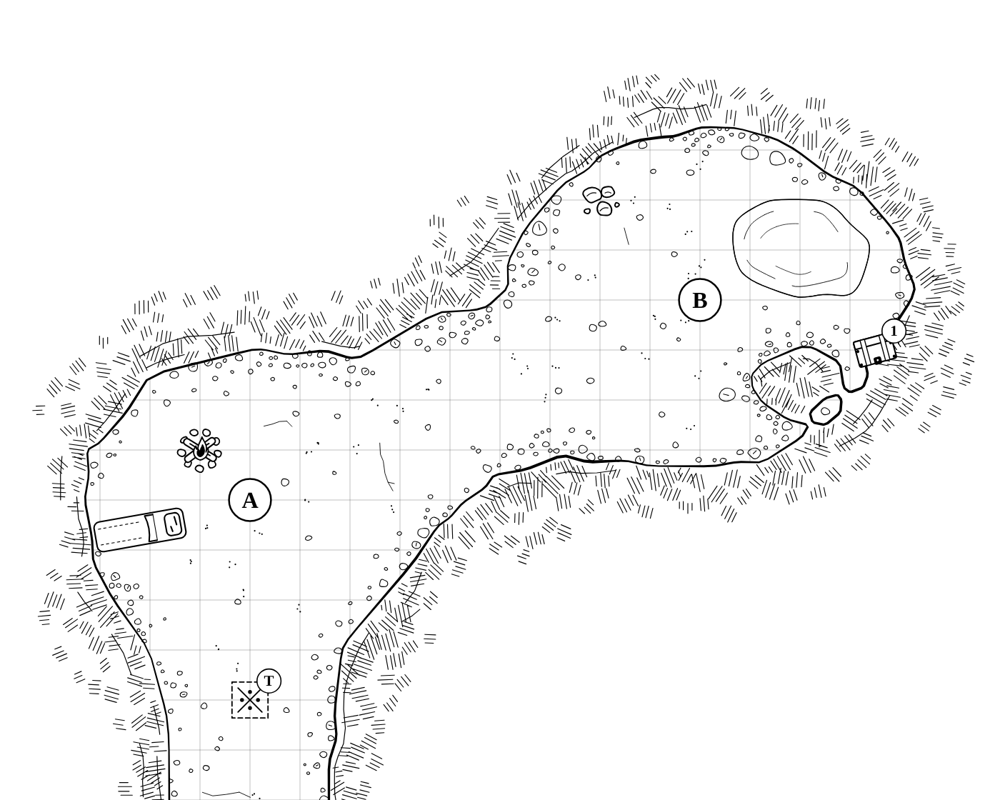
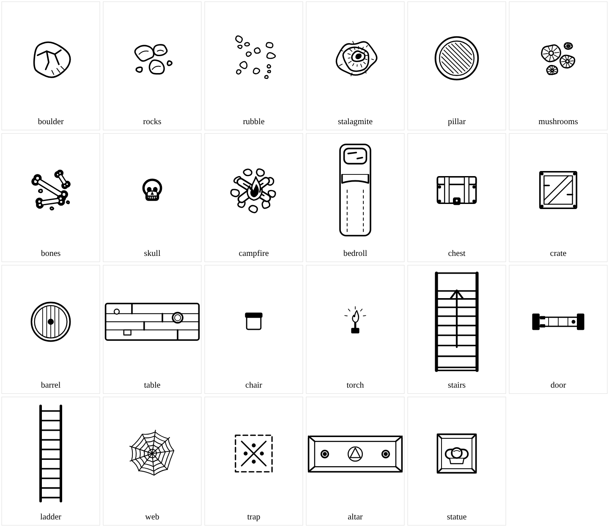

# Cave Battlemap Generator

A dependency-free JavaScript generator that turns a small JSON spec into an SVG **ink line drawing** of a cave battlemap on a 5-ft grid — bold wobbly walls, hatched rock, pebbles, pools and simple line-drawn props. Runs in the browser or with Node; no build step, no Python, no Dungeondraft.



## Quick start

**Browser:** use it online at <https://whelan.github.io/cave-battlemap-generator/>, or open `index.html` locally (paste or load a spec, download the SVG).

**Node (18+):**

```sh
node cli.mjs examples/small-cave.json small-cave.svg            # player map
node cli.mjs examples/dragon-lair.json lair-dm.svg --dm         # DM map: labels, traps, secrets
node cli.mjs examples/small-cave.json out.svg --no-grid --px 100
node cli.mjs --assets assets/                                   # write every asset as its own SVG
node --test                                                     # run the tests
```

| Option | Meaning |
|---|---|
| `--dm` | include labels, traps and `"secret": true` features |
| `--no-grid` | omit the 5-ft grid |
| `--px N` | pixels per cell (default 70) |

## The spec

Units are grid cells (1 cell = 5 ft). A cave is a list of elliptical **chambers** joined by **passages**, plus pillars, pools and features:

```json
{ "name": "Small Cave", "size": [20, 16], "seed": 7,
  "chambers": [{"id": "mouth", "at": [5, 10], "r": [3.5, 3], "label": "A"},
               {"id": "back",  "at": [14, 6], "r": [4, 3.2], "label": "B"}],
  "passages": [{"from": "mouth", "to": "south", "width": 3},
               {"path": ["mouth", [9, 8], "back"], "width": 2.6}],
  "pools":    [{"at": [16, 5], "r": [1.4, 1]}],
  "features": [{"kind": "campfire", "at": [4, 9]}, {"kind": "trap", "at": [5, 14], "label": "T"}] }
```

Full field and asset reference: [docs/spec-reference.md](docs/spec-reference.md). Examples: [examples/small-cave.json](examples/small-cave.json), [examples/dragon-lair.json](examples/dragon-lair.json).

## Use with an AI

[PROMPT.md](PROMPT.md) is a copy-paste prompt for any chat AI (no tools needed). Paste it, describe your cave, and choose:

- **MODE: SPEC** — the AI writes a valid JSON spec for this generator.
- **MODE: SVG** — the AI draws a complete SVG map by hand in the same style.

## Assets

23 simple line-drawn props, each sized to the 5-ft grid: boulder, rocks, rubble, stalagmite, pillar, mushrooms, bones, skull, campfire, bedroll, chest, crate, barrel, table, chair, torch, stairs, door, ladder, web, trap, altar, statue. Use them as `features` in a spec, or export them with `--assets` for use in other tools.



## QA

Every render is checked and a line like `QA Small Cave: 0 FAIL, 1 WARN` is printed; the CLI exits with code 1 on any FAIL.

- **FAIL** — a chamber centre lies in rock, or a chamber is not connected to the first chamber.
- **WARN** — an edge exit does not reach the map edge, a feature sits in rock, or the floor covers less than 20 % or more than 80 % of the map.
