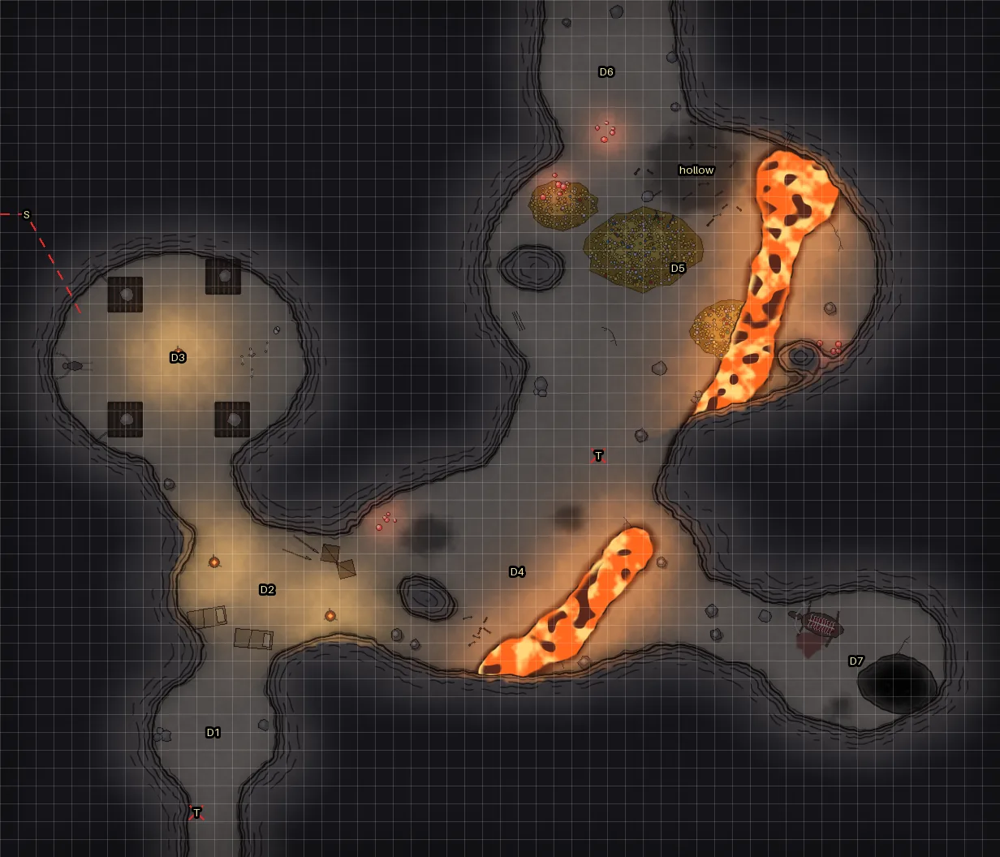
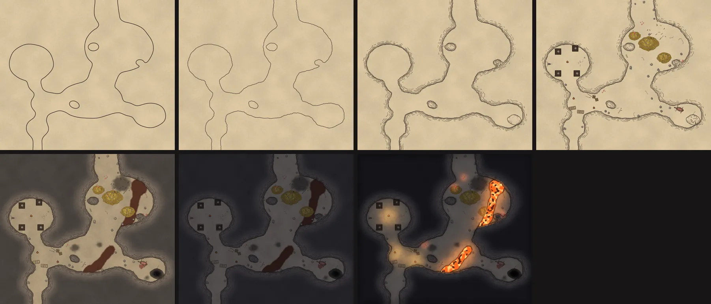

# cave-battlemap-generator

Hand-drawn cave battlemaps from a small YAML spec. The painter needs no image model, only numpy and
Pillow: it inks the walls, washes in watercolour, lays a night layer over everything and lets the
lights burn through. The same spec also gives you Foundry VTT walls and lights, and a Dungeondraft
map dressed with Forgotten Adventures assets.



Same spec, same seed, same cave, at any size: change one chamber and only that chamber moves.

## Install

```bash
pip install -e .            # numpy, pillow, pyyaml
pip install -e ".[test]"    # + pytest
```

## Use

```bash
cave-map examples/dragon-lair.yaml --check                      # spec + QA only, a second
cave-map examples/dragon-lair.yaml --preview prev.png --no-map  # small gridded preview with DM tags
cave-map examples/dragon-lair.yaml --dm --out-dir out/          # the full map, a DM copy, Foundry json
cave-map examples/dragon-lair.yaml --steps steps/ --no-map      # the painting stages, one image each
cave-dd  examples/dragon-lair.yaml --plan                       # what the Dungeondraft map would hold
```

`python -m cavemap render …` and `python -m cavemap dd …` do the same without the console scripts.

A spec is a `.yaml` file, or a Markdown note that holds the YAML in a ```cave fence, so a cave can
live inside an Obsidian page next to its read-aloud text.

| Output | What it is |
|---|---|
| `<slug>.webp` | the map, `size × px` pixels (default 100 px per 5-ft cell), no grid |
| `<slug>-dm.webp` | with `--dm`: the same map with area tags, secret passages and traps |
| `<slug>-foundry.json` | scene size and grid, walls traced along the drawn wall line, every light (feet) |
| `<slug>.dungeondraft_map` | from `cave-dd`: the cave as a Dungeondraft map (needs the asset packs) |

## A spec

```yaml
name: Small Cave
size: [20, 16]          # cells, 1 cell = 5 ft
seed: 7
chambers:
  - {id: mouth, at: [5, 10], r: [3.5, 3], label: A}
  - {id: back, at: [14, 6], r: [4, 3.2], label: B}
passages:
  - {from: mouth, to: south, width: 3}            # runs off the south edge
  - {path: [mouth, [9, 8], back], width: 2.6}
pools:
  - {at: [16, 5], r: [1.4, 1]}
features:
  - {kind: camp, at: [4, 9]}                      # bedroll, pack, fire; the fire lights itself
  - {kind: trap, at: [5, 14], label: T}           # DM copy only
glow:
  - {at: [11.5, 4.4], n: 6, color: teal}          # glowing fungus, each cluster a dim light
```

Everything else (ledges, pits, streams, stairs, lava, stalagmites, nests, cages, shackled corpses,
statues, treasure mounds, torches, braziers, moonlight, soot, secret passages) is in
[docs/spec-reference.md](docs/spec-reference.md).

## QA

Every run ends `QA <cave>: n FAIL, n WARN` and exits 1 on a FAIL.

- **FAIL**: a chamber whose centre is rock, or one with no path at least 5 ft wide to the first chamber.
- **WARN**: an exit that does not reach the map edge, a feature or light sitting in the rock, a rock
  speck where two shapes almost touch, a chamber centred in a pit, floor outside 20–80 % of the map,
  no light at all.

## How it paints



[docs/technique.md](docs/technique.md) walks through the stages and the knobs that change them.
[docs/dungeondraft.md](docs/dungeondraft.md) covers the Dungeondraft export and its asset mapping.

## Credit

The painting stages follow the cave-drawing tutorial by
[The Reclusive Cartographer](https://www.patreon.com/thereclusivecartographer): outline, jagged
line, layered walls, details, diffuse colour, a dark blue layer, highlights and shade. No art from
the tutorial is used; this repo only automates the method.
